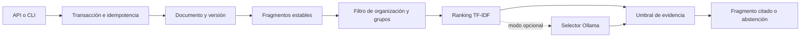

# Arquitectura

`documents` almacena la última versión y su grupo. `chunks` conserva segmentos de aproximadamente 700 caracteres y sus posiciones. Una actualización reemplaza los segmentos dentro de la misma transacción; no quedan citas antiguas en el índice. La auditoría registra organización, cantidad y resultado, sin guardar la consulta completa en el evento.

El ranking normaliza acentos, elimina palabras frecuentes y calcula coseno de vectores TF-IDF. Exige cobertura mínima de términos y una puntuación mínima. Es una heurística lexical explícita, sin interpretar las puntuaciones como probabilidades. Los filtros SQL se aplican antes de construir el corpus de ranking.

En modo Ollama se admite únicamente un `source_id` de los candidatos. El texto de respuesta procede del fragmento almacenado: el modelo no puede sustituirlo por una afirmación libre. Las instrucciones incrustadas en documentos se presentan como datos. Esto reduce la superficie generativa; no convierte el contenido documental en confiable.

El host HTTP abre una conexión por petición. SQLite serializa escrituras y la transacción incluye cambios, auditoría y registro de idempotencia. Los adaptadores de identidad y los repositorios documentales externos quedan fuera del límite local.
