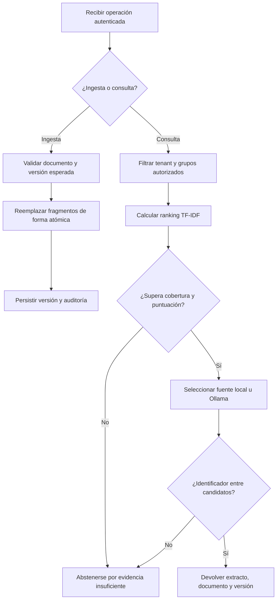

# Flujo de operación

[Abrir SVG](diagrams/flow.svg) · [Fuente Mermaid](diagrams/flow.mmd)

Versión Mermaid

- La actualización de un documento reemplaza sus fragmentos dentro de la misma transacción.
- El corpus usado para calcular TF-IDF contiene sólo documentos visibles; la puntuación no es una probabilidad.
- La selección opcional valida `source_id`; la respuesta conserva el extracto almacenado, no texto libre del modelo.

Las operaciones del dominio se guardan junto a auditoría y respuesta idempotente en la transacción del servicio local. Un error revierte los cambios de esa solicitud.

[Arquitectura](architecture.md) · [Tecnologías y alcance](technologies.md)
